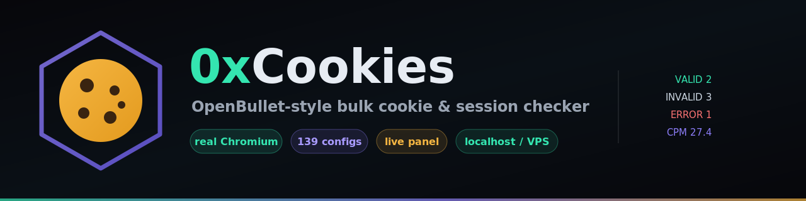

<div align="center">



# 0x Cookies

**Pengecek cookie & sesi massal bergaya OpenBullet — ditenagai Chromium sungguhan.**

Cek massal apakah cookie / login tersimpan masih hidup di **139 platform**.
Berbeda dari pengecek HTTP biasa, tool ini menjalankan **Chromium headless sungguhan**
(Playwright), jadi tetap akurat di situs yang selalu menjawab `HTTP 200`
(Microsoft, sosial media, SaaS, dll).

[](https://www.python.org/)
[](https://playwright.dev/)
[](#-platform-bawaan)
[](../LICENSE)
[](../CONTRIBUTING.md)
[](https://github.com/0xgetz)

[English](../README.md) · [**Indonesia**](README.id.md) · [Español](README.es.md) · [中文](README.zh.md) · [العربية](README.ar.md)

</div>

---

## Kenapa dibuat

Kebanyakan pengecek cookie mengirim satu request HTTP lalu melihat status code. Itu
runtuh begitu situs membalas `200 OK` untuk sesi yang hidup **maupun** yang mati —
hasilnya 100% "valid" padahal isinya sampah. **0x Cookies** memuat halaman di browser
sungguhan, mengikuti redirect, lalu memutuskan dari **URL akhir + DOM** apakah kamu
benar-benar login.

- **Verdict browser asli** — Chromium headless via Playwright.
- **Context terisolasi** — tiap input jalan di browser-context sendiri, cookie tidak
  bocor antar akun dan file mati tak akan pernah terlihat valid.
- **Gagal menang atas sukses** — mendarat di halaman login/error selalu `invalid`.
- **139 platform siap pakai** — plus engine config HTTP + browser generik.
- **Control panel web** — upload input/config/proxy, start/pause/stop, statistik live.
- **CLI runner** — engine yang sama, pas untuk VPS atau cron.
- **Proxy pool** — rotasi dan auto-ban saat gagal (`http/https/socks4/socks5`).

> **Hanya untuk penggunaan yang sah.** Uji akun milikmu sendiri atau yang kamu punya izin
> eksplisit untuk mengujinya. Lihat [Disclaimer](#️-disclaimer).

---

## Mulai cepat

```bash
git clone https://github.com/0xgetz/0x-cookies.git
cd 0x-cookies
./start.sh                 # membuka http://localhost:8080
```

`start.sh` memasang Playwright, mengunduh Chromium, dan menarik library sistem yang
dibutuhkan (apt / dnf / apk). Mau manual?

```bash
pip install playwright
python -m playwright install chromium
python -m playwright install-deps chromium     # Debian/Ubuntu
python server.py --host 0.0.0.0 --port 8080
```

> Buka port **8080** (panel) **dan 8081** (WebSocket statistik live) bila mengakses panel
> dari mesin lain. Bila 8081 diblokir, dashboard otomatis beralih ke polling.

---

## Memakai control panel

1. **Inputs** — tempel satu per baris, atau upload `.txt`.
   mode `userpass` → `user:pass`; mode `cookie` → blob cookie (atau path file cookie).
2. **Config** — tempel JSON, pilih preset, atau muat salah satu dari 139 config di
   `configs/platforms/<nama>.json`.
3. **Proxies** *(opsional)* — satu per baris:
   `host:port`, `user:pass@host:port`, `scheme://host:port`
   (`http` `https` `socks4` `socks5` `socks5h`). Rotasi + ban otomatis.
4. **Options** — workers, timeout, retry, durasi ban proxy, headless on/off.
5. **Start** — pantau tested / hits / invalid / errors / CPM / progress secara live.
6. Unduh **hits** (`data/hits.txt`) dan **semua hasil** (`data/all.txt`).

---

## Platform bawaan

**139 konfigurasi** ada di [`configs/platforms/`](../configs/platforms), mencakup
sosial, email, cloud, developer, keuangan, streaming, belanja, dan lainnya — mis.
`google` `microsoft` `github` `discord` `instagram` `tiktok` `netflix` `spotify`
`openai` `claude` `notion` `aws` `binance` `paypal` `steam` …

Tiap config adalah cek `redirect` (situs memantulkan user anonim) atau cek `marker`
(SPA: dicocokkan lewat selector DOM valid/invalid dan penanda body). Regenerate semua:

```bash
python gen_configs.py
```

---

## Format config (gaya OpenBullet)

```json
{
  "name": "Site login check",
  "author": "0x Cookies",
  "type": "http",
  "input_format": "userpass",
  "request": {
    "url": "https://site.com/api/login",
    "method": "POST",
    "headers": { "Cookie": "<COOKIE>", "User-Agent": "Mozilla/5.0" },
    "body": "user=<USER>&pass=<PASS>"
  },
  "captures": [ { "name": "token", "regex": "\"token\"\\s*:\\s*\"([^\"]+)\"" } ],
  "success": { "status": [200], "body_regex": "\"ok\":true", "url_regex": "/dashboard" },
  "fail":    { "body_regex": "invalid|incorrect", "url_regex": "(login|signin)" },
  "retry": 1
}
```

| Field | Arti |
|-------|------|
| `type` | `http` = request langsung · `browser` = muat halaman di Chromium |
| `input_format` | `line` · `userpass` · `cookie` |
| `request` | url / method / headers / body (khusus HTTP) |
| `captures` | regex capture yang ditulis ke file **hits** |
| `success` / `fail` | `status` · `body_regex` · `url_regex` |
| var template | `<USER>` `<PASS>` `<LINE>` `<COOKIE>` bisa dipakai di url, header, body **dan** regex |

**`fail` selalu menang atas `success`** — jika URL akhir cocok halaman login/error,
hasilnya `invalid`, apa pun yang lain cocok.

---

## CLI

```bash
# config HTTP
python cli.py --config configs/example_http.json --inputs users.txt \
  --proxies proxies.txt --workers 8 --timeout 30 \
  --hits hits.txt --all all.txt

# cek cookie browser memakai platform bawaan
python cli.py --config configs/platforms/github.json --inputs cookies/ \
  --workers 4 --headful
```

---

## REST API

| Method | Path | Body |
|--------|------|------|
| `POST` | `/api/inputs` | `{"text":"a\nb"}` atau `{"lines":[...]}` |
| `POST` | `/api/config` | `{"raw":"<json>"}` atau objek config |
| `POST` | `/api/proxies` | `{"text":"host:port\n..."}` |
| `POST` | `/api/start` | `{"workers":4,"timeout":30,"retry":1,"headless":true}` |
| `POST` | `/api/stop` · `/api/pause` · `/api/resume` | — |
| `GET` | `/api/stats` | stats + log |
| `GET` | `/api/hits` · `/api/all` | hasil (text) |
| `WS` | `ws://host:8081/` | push stats + log tiap 0.5s |

Set `OXC_TOKEN` untuk mewajibkan header `X-Auth-Token` pada setiap `POST`.

---

## Struktur proyek

Lihat **[STRUCTURE.md](../STRUCTURE.md)** untuk diagram lengkap beranotasi.

```
0x-cookies/
├── server.py          control panel (HTTP + WebSocket statistik live)
├── cli.py             runner headless
├── start.sh           launcher sekali-jalan (install browser + libs)
├── gen_configs.py     generate 139 config platform
├── core/              config · engine · proxies
├── web/               UI dashboard
├── configs/           contoh + config per-platform
├── docs/              5 README terjemahan
└── assets/            logo + banner
```

---

## VPS tanpa root (library Chromium manual)

Bila `apt` tidak tersedia dan Chromium gagal dengan
`error while loading shared libraries: libglib-2.0.so.0`:

```bash
mkdir -p third_party/lib
cp /path/to/*.so* third_party/lib/   # kumpulkan file .so yang kurang
./start.sh                            # start.sh menambahkan third_party/lib ke LD_LIBRARY_PATH
```

---

## Kontribusi

Issue dan PR dipersilakan — terutama config platform baru. Lihat
[CONTRIBUTING.md](../CONTRIBUTING.md).

## Lisensi

[MIT](../LICENSE) © 0x Cookies

## ⚠️ Disclaimer

Tool ini disediakan untuk **riset keamanan yang sah dan menguji akun milikmu sendiri
atau yang kamu punya izin eksplisit untuk mengujinya**. Kamu sepenuhnya bertanggung
jawab atas cara pemakaiannya. Jangan pernah memakainya terhadap sistem atau akun tanpa izin.

---

<div align="center">

Dibuat oleh **0x Cookies** · [GitHub @0xgetz](https://github.com/0xgetz) · [Telegram @xiyyyyz](https://t.me/xiyyyyz)

</div>
